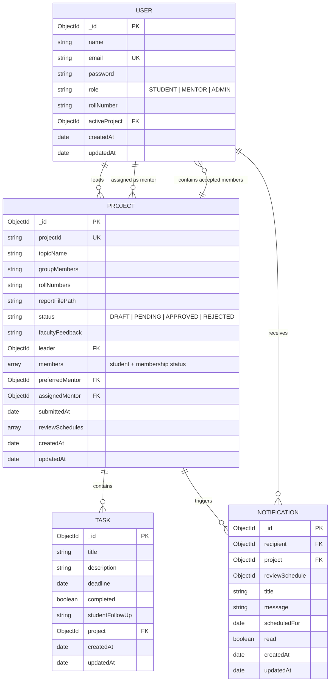

# Final Year Project Management System

A full-stack web application engineered to streamline, monitor, and manage the lifecycle of final year academic projects. The platform facilitates structured collaboration between students and faculty mentors through role-based access control, project proposal workflows, milestone tracking, and review scheduling.

---

## Table of Contents

- [Overview](#overview)
- [Problem Statement](#problem-statement)
- [Objectives](#objectives)
- [User Roles](#user-roles)
- [Key Features](#key-features)
- [Technology Stack](#technology-stack)
- [System Architecture](#system-architecture)
  - [Frontend Architecture](#frontend-architecture)
  - [Backend Architecture](#backend-architecture)
  - [Database Schemas](#database-schemas)
- [Project Folder Structure](#project-folder-structure)
- [Prerequisites](#prerequisites)
- [Installation & Setup](#installation--setup)
  - [1. Backend Setup](#1-backend-setup)
  - [2. Frontend Setup](#2-frontend-setup)
- [Environment Configuration](#environment-configuration)
- [API Reference](#api-reference)
- [Screenshots](#screenshots)
- [Future Enhancements](#future-enhancements)
- [License](#license)

---

## Overview

The **Final Year Project Management System** provides an organized digital environment where academic institutions can coordinate undergraduate capstone projects. It replaces ad-hoc spreadsheets, email threads, and physical paperwork with a centralized dashboard that tracks project statuses, mentor reviews, actionable milestones, and faculty meeting schedules in real time.

---

## Problem Statement

Managing final year projects in academic institutions typically suffers from:
- **Fragmented Communication**: Project updates, feedback, and milestone submissions are scattered across disparate channels.
- **Lack of Transparency**: Students are often unclear about their project's approval status or upcoming review deadlines.
- **Administrative Overhead**: Faculty mentors spend excessive time manually scheduling evaluations, tracking multi-group deadlines, and maintaining records.
- **Accountability Gaps**: Without structured milestone tracking and follow-up logs, verifying individual or team progress is difficult.

---

## Objectives

- Provide a secure, role-based platform for students and faculty mentors.
- Give administrators global visibility and control over mentor account provisioning and project assignments.
- Automate the project proposal, approval, feedback, and resubmission lifecycle.
- Enable mentors to assign actionable tasks and track student follow-up responses.
- Centralize review meeting scheduling with automated in-app notifications for students.
- Offer an intuitive user interface with dedicated student and mentor dashboards.

---

## User Roles

| Role | Description |
| :--- | :--- |
| **Student (`STUDENT`)** | Registers with a required roll number, creates projects as a team leader or requests to join using a project ID. The leader approves members and is the only student who can submit project links. All members track feedback, milestones, and review notifications. |
| **Mentor (`MENTOR`)** | Created by an admin; reviews projects assigned to them, assigns tasks and deadlines, toggles milestone completion, schedules meetings, and monitors their project teams. |
| **Admin (`ADMIN`)** | Bootstrapped from environment credentials; creates mentor accounts, views all students and projects, and assigns a mentor to each project. |

---

## Key Features

### 1. Authentication & Role-Based Access Control
- Secure user registration and login with encrypted password storage (`bcryptjs`).
- JWTs are signed with the configured `JWT_SECRET` and protected backend routes enforce account roles.
- JWT-based authentication with Bearer tokens and role verification middleware.
- Public registration is student-only. Admins create mentor accounts; the first admin is seeded from backend environment variables.
- Student roll numbers are required during registration; existing students without one must complete their profile before creating or joining a project.
- Permanent account deletion with cascading cleanup of associated projects, tasks, and notifications.

### 2. Project Teams & Proposal Lifecycle
- Students create projects as their leader or request membership in another project using its stable, unique project ID.
- The project ID is a durable identifier, not an invitation credential. Knowing it only allows a student to send a join request; the leader must accept the request.
- Each student may participate in at most one ongoing project. Mentor approval ends that participation and allows the student to create or join another project.
- A new project begins as `DRAFT`. Only its leader can submit the project link or report; it moves to `ASSIGNED` when a mentor is assigned, otherwise `PENDING`. Assigning a mentor to a submitted `PENDING` project changes it to `ASSIGNED`.
- Unassigning a mentor from a submitted `ASSIGNED` project returns it to `PENDING`.
- An approved project can be reopened for mentor review when its leader uploads a new report, unless a team member already has another ongoing project.
- The assigned mentor reviews submissions as `APPROVED` or `REJECTED` and can provide feedback. A rejected project can be resubmitted by its leader.
- The leader may choose a preferred mentor. An admin assigns or changes the actual mentor for each project.

### 3. Milestone & Task Tracking
- Mentors assign targeted tasks with specific deadlines to approved projects.
- Mentors can toggle task status between Completed and Pending.
- Students submit detailed follow-up notes on assigned tasks to report progress.

### 4. Review & Meeting Scheduler
- Mentors schedule formal project review meetings with titles, timestamps, and notes.
- Scheduled reviews generate in-app notifications for the project's accepted team members.
- Mentors can cancel or delete scheduled meetings, automatically removing associated notifications.

### 5. Mentor Overview & Student Directory
- Dedicated Student List page enabling mentors to search assigned team members and monitor their project statuses.
- Admin dashboard for creating mentor accounts, viewing all students/mentors/projects, and assigning mentors to unassigned projects.

---

## Technology Stack

### Frontend
- **Framework / Library**: React 19 (`react`, `react-dom`)
- **Build Tool**: Vite 8
- **Routing**: React Router DOM (v7)
- **HTTP Client**: Axios with request interceptor for JWT authorization
- **Icons**: Lucide React (`lucide-react`)
- **Code Quality**: Oxlint

### Backend
- **Runtime**: Node.js
- **Server Framework**: Express.js (v5)
- **Database**: MongoDB with Mongoose ODM (v9)
- **Authentication**: JSON Web Tokens (`jsonwebtoken`) & `bcryptjs`
- **Security & Utilities**: CORS, Dotenv

---

## System Architecture

### Frontend Architecture
- **State Management**: React Context API (`AuthContext`) manages global authentication state, token storage, and session persistence in `localStorage`.
- **API Layer**: Centralized Axios instance (`src/services/api.js`) automatically attaches `Authorization: Bearer <token>` to outbound HTTP requests.
- **Routing Structure**:
  - `/auth` - Student registration and sign-in for students, mentors, and admins.
  - `/student-dashboard` - Create/join projects, share project IDs, manage join requests, submit project links, respond to tasks, and view notifications.
  - `/mentor-dashboard` - Review assigned projects, create milestones, and update task status.
  - `/admin-dashboard` - Create mentor accounts, view all users/projects, and assign project mentors.
  - `/meetings` - Review scheduling interface and meeting timeline.
  - `/students` - Mentor-exclusive directory of assigned students.
- **Route Guards**: `ProtectedRoute` restricts frontend pages by account role; the API independently enforces authorization.
- **Layout & Navigation**: Reusable `Sidebar` and `NavBar` components with responsive styling.

### Backend Architecture
Built following the **Model-View-Controller (MVC)** architectural pattern:
- **Entry Point** (`server.js`): Configures Express middleware, connects to MongoDB, migrates existing projects, bootstraps the initial admin, and registers auth, project, and admin endpoints.
- **Controllers**:
  - `authController.js`: Manages student registration, login, profile updates, mentor lookups, and account deletion.
  - `projectController.js`: Handles project creation, joining/leader decisions, project submissions and reviews, tasks, meetings, and notifications.
  - `adminController.js`: Provides admin overviews, mentor provisioning, and per-project mentor assignment.
- **Middleware** (`authMiddleware.js`):
  - `protect`: Verifies JWT from the Authorization header and attaches the user payload to `req.user`.
  - `authorizeRoles`: Restricts route execution to specific roles (`STUDENT`, `MENTOR`, `ADMIN`).
- **Configuration** (`config/db.js`): Asynchronous MongoDB connection using Mongoose.

### Database Schemas



---

## Project Folder Structure

```
fy-project-management-system/
│
├── backend/
│   ├── config/
│   │   ├── db.js                       # MongoDB connection configuration
│   │   └── bootstrap.js                # Legacy project migration and initial admin setup
│   ├── controllers/
│   │   ├── authController.js           # Authentication & user management logic
│   │   ├── projectController.js        # Projects, teams, tasks, reviews & notifications
│   │   └── adminController.js          # Admin overview, mentors, and assignments
│   ├── middleware/
│   │   └── authMiddleware.js           # JWT verification & RBAC authorization
│   ├── models/
│   │   ├── Notification.js             # Notification schema
│   │   ├── Project.js                  # Project proposal schema
│   │   ├── Task.js                     # Milestone / Task schema
│   │   └── User.js                     # User schema (Students & Mentors)
│   ├── routes/
│   │   ├── authRoutes.js               # Authentication routes
│   │   ├── projectRoutes.js            # Project management routes
│   │   └── adminRoutes.js              # Administrator-only routes
│   ├── utils/
│   │   ├── projectAccess.js            # Project membership and access policies
│   │   └── projectId.js                # Stable project ID generation
│   ├── tests/
│   │   └── projectAccess.test.js       # Project lifecycle and access tests
│   ├── .env                            # Local environment variables (git-ignored)
│   ├── .env.example                    # Template for environment configuration
│   ├── package.json                    # Backend dependencies and npm scripts
│   ├── package-lock.json               # Backend dependency lockfile
│   └── server.js                       # Express server entry point
│
├── frontend/
│   ├── public/
│   │   ├── favicon.svg                 # Application favicon
│   │   └── icons.svg                   # SVG icon sprite
│   ├── src/
│   │   ├── assets/                     # Static media and logos
│   │   ├── components/
│   │   │   ├── NavBar.jsx              # Navigation header component
│   │   │   ├── ProtectedRoute.jsx      # Route-guard component based on role
│   │   │   ├── Sidebar.css             # Sidebar layout styling
│   │   │   └── Sidebar.jsx             # Navigation sidebar with quick actions
│   │   ├── context/
│   │   │   └── AuthContext.jsx         # React Context for auth state & actions
│   │   ├── pages/
│   │   │   ├── Auth.jsx                # Sign-in and registration page
│   │   │   ├── Meetings.jsx            # Review meeting scheduling & management
│   │   │   ├── MentorDashboard.jsx     # Mentor project evaluation & task manager
│   │   │   ├── StudentDashboard.jsx    # Student project submission & milestone view
│   │   │   ├── StudentList.jsx         # Directory of assigned students for mentors
│   │   │   └── AdminDashboard.jsx      # Mentor provisioning and project assignment
│   │   ├── services/
│   │   │   └── api.js                  # Axios client configured with interceptors
│   │   ├── App.css                     # Global view styling
│   │   ├── App.jsx                     # Router declaration and view composition
│   │   ├── index.css                   # Global styles and design system variables
│   │   └── main.jsx                    # React application root entry point
│   ├── index.html                      # Single page application HTML shell
│   ├── package.json                    # Frontend dependencies and build scripts
│   ├── package-lock.json               # Frontend dependency lockfile
│   └── vite.config.js                  # Vite bundler configuration
│
├── .gitignore                          # Root Git exclusion rules
└── README.md                           # Comprehensive project documentation
```

---

## Prerequisites

Before running the application locally, ensure you have the following installed:
- [Node.js](https://nodejs.org/) (v20.19.0+ or v22.12.0+ for the current Vite version)
- [npm](https://www.npmjs.com/) (bundled with Node.js)
- [MongoDB](https://www.mongodb.com/) (running locally on port `27017` or a MongoDB Atlas connection string)
- [Git](https://git-scm.com/)

---

## Installation & Setup

Clone the repository to your local machine:

```bash
git clone <REPOSITORY_URL>
cd fy-project-management-system
```

### 1. Backend Setup

1. Navigate to the `backend` directory:
   ```bash
   cd backend
   ```

2. Install backend dependencies:
   ```bash
   npm install
   ```

3. Create your `.env` file from the provided template:
   ```bash
   cp .env.example .env
   ```

4. Configure the variables in `.env` (ensure MongoDB is accessible).

5. Start the backend development server:
   ```bash
   # Development mode with auto-reload (nodemon)
   npm run dev

   # Production mode
   npm start
   ```

   The backend will start and listen on port `5000` (or the configured `PORT`).

---

### 2. Frontend Setup

1. Open a new terminal and navigate to the `frontend` directory:
   ```bash
   cd frontend
   ```

2. Install frontend dependencies:
   ```bash
   npm install
   ```

3. Start the Vite development server:
   ```bash
   npm run dev
   ```

4. Open your browser and navigate to `http://localhost:5173` to access the application.

5. To create an optimized production build:
   ```bash
   npm run build
   ```

---

## Environment Configuration

Backend configuration is handled via environment variables in `backend/.env`.

| Variable | Description | Example / Default Value |
| :--- | :--- | :--- |
| `PORT` | Port number on which the Express server listens | `5000` |
| `MONGO_URI` | MongoDB connection URI | `mongodb://localhost:27017/project_management_db` |
| `JWT_SECRET` | Private secret used to sign and verify JWTs (minimum 32 characters) | Generate a long random value |
| `ADMIN_NAME` | Name for the initial admin account | Set before the first backend startup |
| `ADMIN_EMAIL` | Email for the initial admin account | Set before the first backend startup |
| `ADMIN_PASSWORD` | Password for the initial admin account (minimum 8 characters) | Use a strong private password |
| `R2_ACCOUNT_ID` | Cloudflare account ID for the R2 S3 endpoint | Cloudflare dashboard account ID |
| `R2_BUCKET_NAME` | Private R2 bucket used for report objects | `project-management-system-reports` |
| `R2_ACCESS_KEY_ID` | R2 S3 Access Key ID with bucket-scoped Object Read & Write permissions | Create an R2 API token |
| `R2_SECRET_ACCESS_KEY` | Secret Access Key paired with the R2 token | Save it securely when the token is created |

> **Security Note**: Never commit `.env` files containing real production secrets or connection strings to version control. Use `.env.example` as a template.
>
> The backend creates the initial admin only when no admin account exists. Configure all three `ADMIN_*` values together. The server will not start if no admin exists and these values are missing. Later mentor accounts are created by an admin with a temporary password to be shared securely.
>
> Enable R2, create the private bucket, and create an R2 S3 API token scoped to that bucket with Object Read & Write permissions before uploading reports. New uploads use R2; older local reports remain downloadable from `backend/uploads/reports/`.

Existing projects are migrated on backend startup: each receives a stable project ID, the existing owner becomes the leader, and its current student-level mentor assignment is copied to the project when available. Students without an existing mentor remain unassigned until an admin assigns one.

---

## API Reference

### Authentication Endpoints (`/api/auth`)

| Method | Endpoint | Access | Description |
| :--- | :--- | :--- | :--- |
| `POST` | `/api/auth/register` | Public | Register a student account. Mentor and admin registration is not public. |
| `POST` | `/api/auth/login` | Public | Authenticate a user with email, password, and expected role. Returns JWT. |
| `GET` | `/api/auth/mentors` | Public | List mentors for project preference selection. |
| `PUT` | `/api/auth/profile` | Protected | Update the authenticated user's name or roll number. |
| `DELETE` | `/api/auth/account` | Protected | Delete authenticated user account and cascade delete associated records. |

### Administrator Endpoints (`/api/admin`)

All routes require an admin JWT.

| Method | Endpoint | Description |
| :--- | :--- | :--- |
| `GET` | `/api/admin/overview` | View all students, mentors, projects, and unassigned projects. |
| `POST` | `/api/admin/mentors` | Create a mentor account using a name, email, and temporary password. |
| `PUT` | `/api/admin/projects/:projectId/mentor` | Assign or unassign a mentor using the project's stable ID. |

### Project Management Endpoints (`/api/projects`)

Pass the JWT in the `Authorization: Bearer <token>` request header.

All endpoints below require a valid JWT token passed in the `Authorization: Bearer <token>` header.

| Method | Endpoint | Role | Description |
| :--- | :--- | :--- | :--- |
| `GET` | `/api/projects` | Authenticated | Fetch leader/member projects, assigned mentor projects, or all projects for admins. |
| `GET` | `/api/projects/my-requests` | `STUDENT` | View the student's pending/rejected join requests. |
| `POST` | `/api/projects` | `STUDENT` | Create a `DRAFT` project and receive its stable project ID; the creator is its leader. |
| `POST` | `/api/projects/join` | `STUDENT` | Request membership using a stable project ID; the leader must approve the request. |
| `PUT` | `/api/projects/:id/members/:studentId` | Project leader | Approve or reject a pending team membership request. |
| `PUT` | `/api/projects/:id/submit` | Project leader | Submit the project link and move the project to `PENDING`. |
| `PUT` | `/api/projects/:id/resubmit` | Project leader | Resubmit a rejected project link. |
| `PUT` | `/api/projects/:id/review` | Assigned `MENTOR` | Approve or reject a submitted project and provide feedback. |
| `POST` | `/api/projects/:id/tasks` | Assigned `MENTOR` | Assign a milestone/task with a deadline to an approved project. |
| `GET` | `/api/projects/:id/tasks` | Project member/assigned mentor | Fetch tasks for a project the caller can access. |
| `PUT` | `/api/projects/tasks/:taskId/followup` | `STUDENT` project member | Submit follow-up notes on a project task. |
| `PUT` | `/api/projects/tasks/:taskId/status` | Assigned `MENTOR` | Toggle task completion status. |
| `POST` | `/api/projects/:id/reviews` | Assigned `MENTOR` | Schedule a review and notify accepted project members. |
| `DELETE` | `/api/projects/:id/reviews/:reviewId` | Assigned `MENTOR` | Delete a scheduled review and its notifications. |
| `GET` | `/api/projects/notifications` | `STUDENT` | Retrieve triggered review meeting notifications for the student. |

---

## Screenshots

<!-- Add application screenshots here -->

### 1. Authentication Portal
*Student registration and role-based sign-in for students, mentors, and admins*


### 2. Student Dashboard
*Project proposal submission, status tracking, task responses, and notifications*
> *Screenshot placeholder: Capture of the Student Dashboard view*

### 3. Mentor Dashboard
*Proposal evaluation, milestone assignment, and meeting scheduler*
> *Screenshot placeholder: Capture of the Mentor Dashboard view*

---

## Future Enhancements

The following roadmap items represent potential additions to be implemented in upcoming releases:
- [ ] **Live Chat & Discussions**: Real-time WebSocket-based messaging between students and their assigned mentors.
- [ ] **Rubric-Based Grading**: Evaluation scoring sheets and rubrics for final presentations.
- [ ] **Calendar Integration**: Google Calendar / iCal export for scheduled review meetings.
- [ ] **Email Alerts**: Automated email notifications via Nodemailer for review invites and deadline reminders.
- [ ] **Multi-Mentor Teams**: Support for co-mentors and external panel evaluators.

---

## License

This project is licensed under the [ISC License](https://opensource.org/licenses/ISC).
# Project-Management

